# Blockchain Vehicle Data Integrity System — Architecture

---

## 1. High-Level System Overview

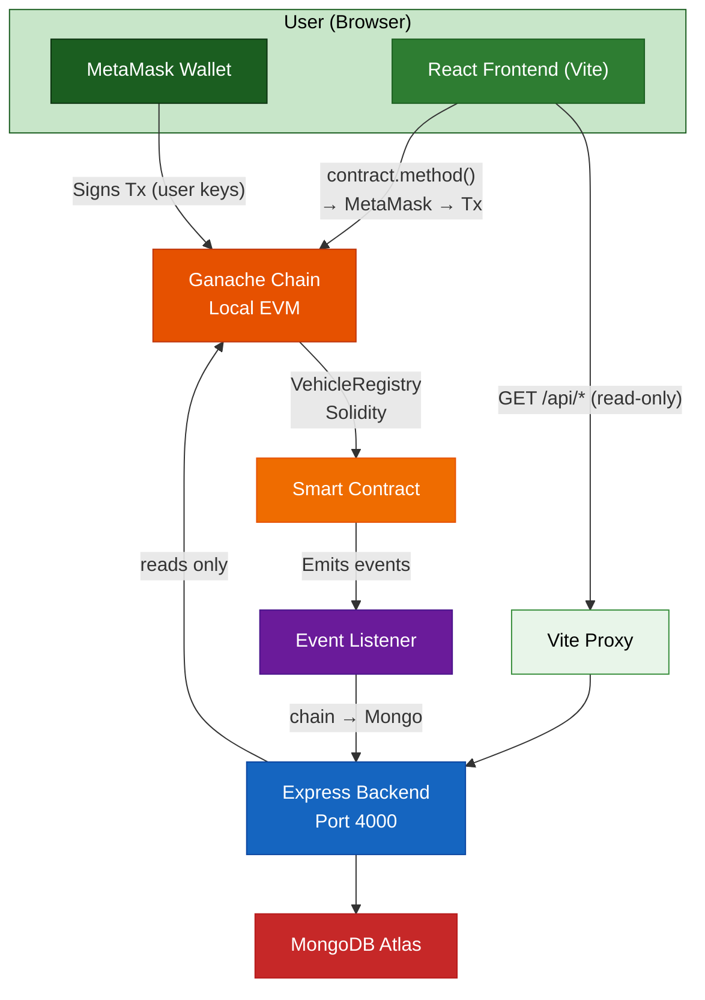

---

## 2. Component Responsibilities

| Layer | Technology | Role |
|-------|-----------|------|
| **User** | MetaMask | Signs transactions with private key; never exposed to backend |
| **Frontend** | React + ethers.js | UI for all operations; sends write txs via MetaMask, reads via API |
| **Blockchain** | Ganache + Solidity | Source of truth; stores vehicles, records, roles, access control |
| **Backend** | Express + ethers.js (read-only) | REST API for reads; event listener syncs chain → MongoDB |
| **Database** | MongoDB Atlas | Read-optimized cache for search, filtering, pagination |

---

## 3. Data Flow

### 3a. Write Path (User → Chain)

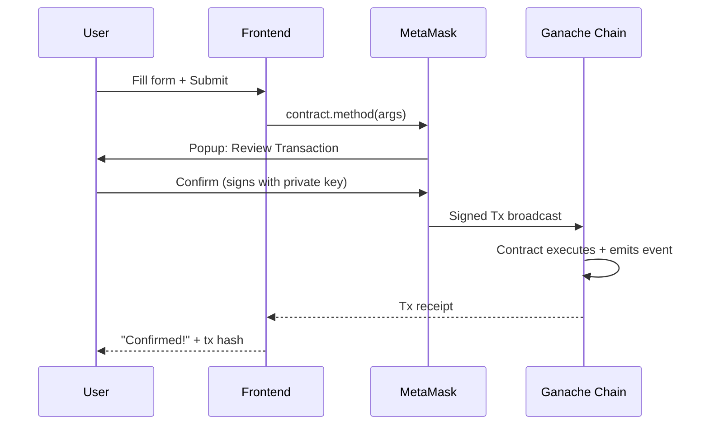

### 3b. Sync Path (Chain → MongoDB)

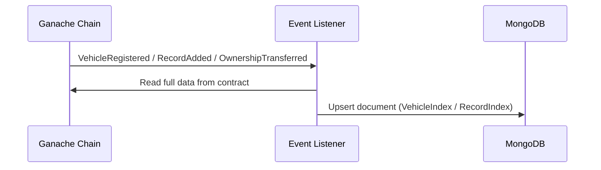

### 3c. Read Path (User ← MongoDB/Chain)

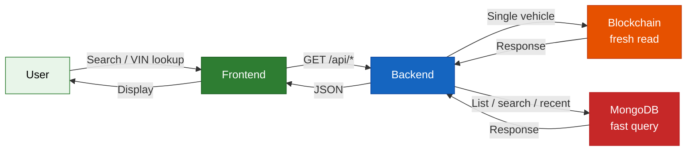

### 3d. Photo Upload Path (Owner-Signed, Off-Chain File)

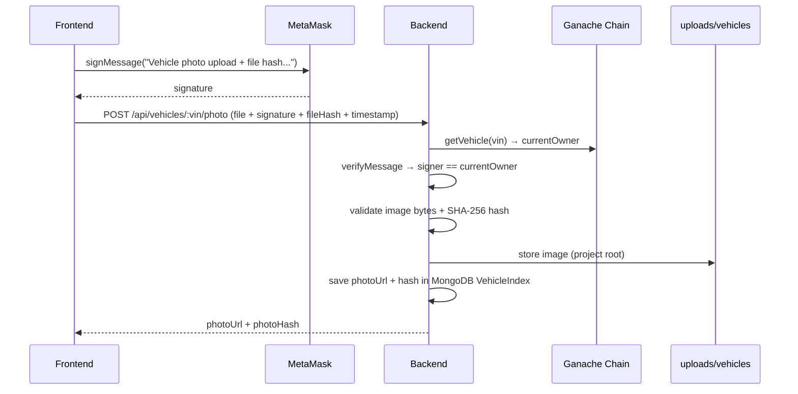

The photo file is **not** written to the blockchain (too expensive). Instead the chain remains
the authority for ownership, while the owner signature authorizes the off-chain upload and is
bound to the image's SHA-256 hash. The hash stored in MongoDB can later be anchored on-chain
for stronger tamper evidence.

### 3e. Trust, Passport, Due Diligence & Analytics Read Path

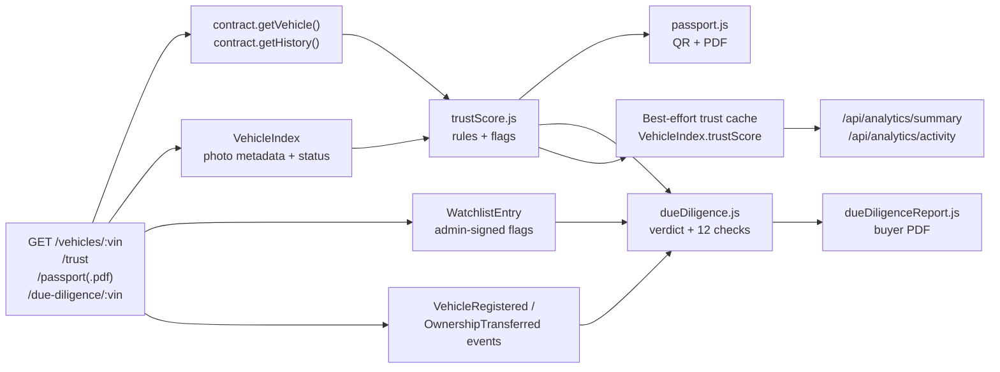

- **Chain first:** the vehicle and its history are always read from the contract.
- **Explainable scoring:** every point and every fraud flag is returned, never an opaque number.
- **Ownership trail:** registration and transfer events provide from → to addresses; the report
  falls back to `OWNERSHIP_TRANSFER` history records when events are unavailable.
- **Off-chain rendering:** QR/PDF generation and dashboard aggregation never mutate chain state.
- **Watchlist:** MongoDB rows written only with an admin wallet signature; reads are public and
  feed the due-diligence verdict.
- **Best-effort cache:** trust scores are cached on `VehicleIndex` for fast dashboard queries; a
  failed cache write never fails the vehicle lookup.

---

## 4. Smart Contract: VehicleRegistry.sol

### Access Control

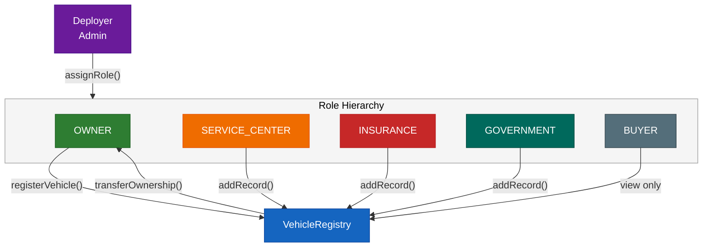

### Key Functions

| Function | Caller | Action |
|----------|--------|--------|
| `registerVehicle(vin, make, model, year)` | Anyone | Creates vehicle, assigns OWNER |
| `addRecord(vin, type, hash, desc)` | SERVICE_CENTER / INSURANCE / GOVERNMENT | Appends immutable record |
| `transferOwnership(vin, newOwner)` | Current owner | Transfers ownership + logs transfer |
| `assignRole(user, role)` | Admin only | Grants role to address |
| `getVehicle(vin)` / `getHistory(vin)` | Public | Read-only queries |

### Events (Bridge to Backend)

| Event | Triggered By | Listener Action |
|-------|-------------|-----------------|
| `VehicleRegistered` | `registerVehicle()` | Create VehicleIndex doc |
| `RecordAdded` | `addRecord()` | Create RecordIndex doc |
| `OwnershipTransferred` | `transferOwnership()` | Update VehicleIndex owner |
| `RoleAssigned` | `assignRole()` | (logged only) |

---

## 5. Backend Structure

```
backend/
├── server.js                    # Express entry point + /uploads static files
├── config/
│   ├── contract.js              # ethers.JsonRpcProvider + read-only Contract
│   ├── db.js                    # Mongoose → MongoDB Atlas
│   ├── env.js                   # Root .env loader
│   ├── paths.js                 # Project-root uploads directory paths
│   └── abi.json                 # Contract ABI (auto-copied)
├── models/
│   ├── VehicleIndex.js          # { vin, owner, recordCount, status, photo metadata }
│   ├── RecordIndex.js           # { vin, type, description, txHash }
│   └── WatchlistEntry.js        # { vin?, owner?, reason, severity, active, addedBy }
├── listeners/
│   └── eventListener.js         # Subscribes to chain events, syncs to Mongo
├── controllers/
│   ├── vehicleController.js     # Vehicle detail, trust, passport, list
│   ├── recordController.js      # getVehicleRecords (mongo), getRecentRecords
│   ├── photoController.js       # Owner-signed photo upload + hashing
│   ├── analyticsController.js   # Dashboard summary + merged activity feed
│   ├── dueDiligenceController.js # Buyer report, comparison, report PDF
│   └── watchlistController.js   # Admin-signed watchlist CRUD
├── services/
│   ├── trustScore.js            # Explainable 0-100 score + fraud flags
│   ├── passport.js              # Passport JSON, QR codes, PDF generation
│   ├── dueDiligence.js          # Verdict engine, 12 checks, timeline, comparison
│   └── dueDiligenceReport.js    # Buyer due-diligence PDF
├── middleware/
│   ├── errorHandler.js          # Error response formatting
│   └── upload.js                # Multer disk storage + image validation
├── routes/
│   ├── vehicles.js              # Detail, trust, passport, PDF, photo routes
│   ├── analytics.js             # /summary + /activity
│   ├── dueDiligence.js          # /:vin, /:vin/report.pdf, /compare
│   ├── watchlist.js             # list, add, resolve
│   └── records.js               # GET /recent
└── utils/
    ├── photoMessage.js          # Canonical message signed by photo uploader
    ├── watchlistMessage.js      # Canonical message signed by admin
    └── recordTypes.js           # Solidity enum ↔ string mapping
```

### Dual Data Source

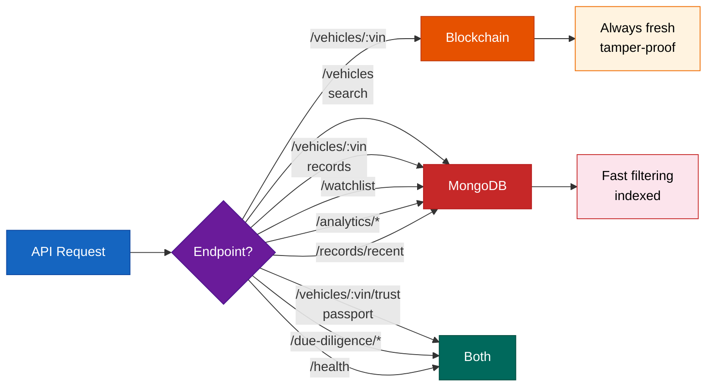

---

## 6. Frontend Structure

```
frontend/src/
├── App.jsx                      # Router + Navbar + Routes
├── contract/
│   ├── abi.json                 # Contract ABI
│   └── config.js                # Contract address + chain ID
├── hooks/
│   └── useWallet.js             # MetaMask connect, role fetch, state
├── api/
│   └── client.js                # fetch() wrappers for all endpoints
│   ├── utils/
│   │   ├── vehiclePhoto.js      # Canonical photo-upload signing message
│   │   └── watchlist.js         # Canonical admin watchlist signing message
│   ├── pages/
│   │   ├── VehicleHistory.jsx   # VIN search + history + photo + trust (no wallet needed)
│   │   ├── RegisterVehicle.jsx  # Register vehicle + required photo (on-chain write)
│   │   ├── AddRecord.jsx        # Add record (role-gated)
│   │   ├── TransferOwnership.jsx # Transfer ownership (owner-only)
│   │   ├── AdminRoles.jsx       # Assign roles + manage watchlist (admin-only)
│   │   ├── Dashboard.jsx        # Live registry analytics + activity feed
│   │   ├── Passport.jsx         # Public QR/PDF vehicle passport
│   │   └── DueDiligence.jsx     # Buyer report + comparison + share/PDF
│   └── components/
│       ├── ConnectWalletButton.jsx # Wallet connection UI
│       ├── RoleBadge.jsx        # Color-coded role display
│       ├── RecordCard.jsx       # Record display card
│       ├── TrustScoreCard.jsx   # Trust gauge + fraud radar + score factors
│       └── WatchlistPanel.jsx   # Admin watchlist add/resolve UI
```

### Write Pattern (All Write Pages)

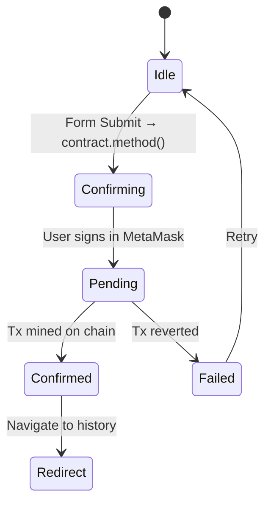

---

## 7. Contract ↔ Backend ↔ Frontend Integration

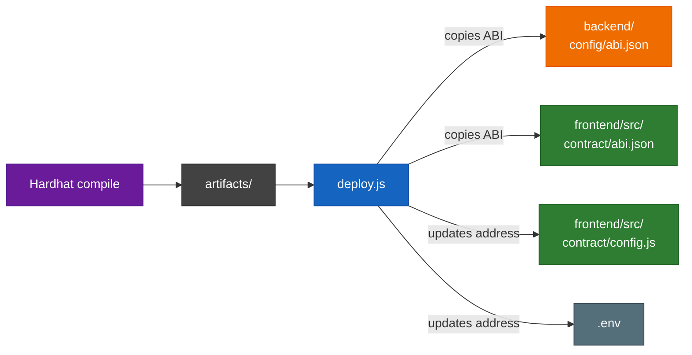

---

## 8. Key Architectural Principles

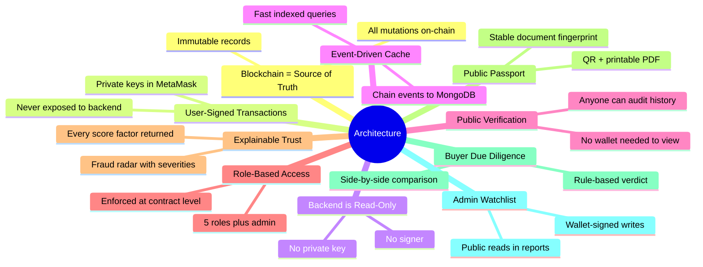

---

## 9. API Reference

| Method | Endpoint | Source | Purpose |
|--------|----------|--------|---------|
| GET | `/api/vehicles/:vin` | Chain + Mongo | Vehicle detail + live history + photo metadata + trust score |
| GET | `/api/vehicles` | Mongo | Search/filter vehicles |
| GET | `/api/vehicles/:vin/records` | Mongo | Record list for VIN |
| GET | `/api/vehicles/:vin/trust` | Chain + Mongo | Explainable trust score + fraud flags |
| GET | `/api/vehicles/:vin/passport` | Chain + Mongo | Public passport JSON + QR data URL |
| GET | `/api/vehicles/:vin/passport.pdf` | Chain + Mongo | Printable A4 passport PDF |
| POST | `/api/vehicles/:vin/photo` | File + Mongo | Owner-signed photo upload/replacement |
| GET | `/uploads/vehicles/:file` | Filesystem | Serve stored vehicle photo |
| GET | `/api/records/recent` | Mongo | Recent records globally |
| GET | `/api/analytics/summary` | Mongo | Registry KPIs, trust distribution, daily activity |
| GET | `/api/analytics/activity` | Mongo | Merged live feed (registrations, records, photos) |
| GET | `/api/due-diligence/:vin` | Chain + Mongo | Buyer verdict, 12 checks, alerts, ownership timeline |
| GET | `/api/due-diligence/:vin/report.pdf` | Chain + Mongo | Printable buyer due-diligence PDF |
| GET | `/api/due-diligence/compare` | Chain + Mongo | Two-VIN comparison + recommended winner |
| GET | `/api/watchlist` | Mongo | List active/resolved watchlist entries |
| POST | `/api/watchlist` | Mongo (admin-signed) | Add a watchlist entry |
| POST | `/api/watchlist/:id/resolve` | Mongo (admin-signed) | Resolve a watchlist entry |
| GET | `/api/health` | Both | Chain + DB health check |

---

## 10. Technology Stack Summary

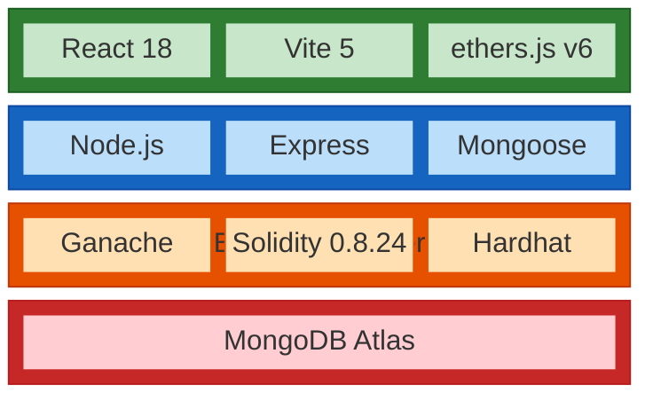
